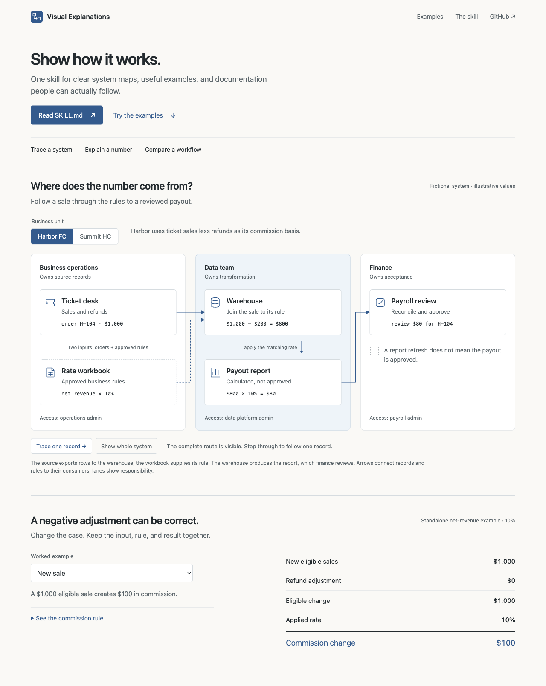

# Visual Explanations

**Show the source. Follow the rule. Make the result obvious.**

One reusable skill for system diagrams, worked examples, and clear technical documentation. Built around a simple preference: less prose to decode, more mechanism to see.

[**Explore the live examples →**](https://jerryshi042003.github.io/visual-explanations/) · [Read the skill](SKILL.md) · [Inspiration & credits](references/inspiration.md)



## One entry point

[**SKILL.md**](SKILL.md) contains the complete workflow: source research, ownership boundaries, business-unit differences, visual choices, worked examples, typography, purposeful interaction, prompt templates, and verification.

Give it to your coding agent with the task and source material:

```text
Read SKILL.md. Explain this system for a new analyst.
Trace one record from its source to the final result.
Show what changes between business units and who owns each handoff.
Keep the useful examples and rule dropdowns. Verify facts before drawing.
```

To install in Codex, clone this repository into an unused skill folder:

```sh
git clone https://github.com/jerryshi042003/visual-explanations.git \
  ~/.codex/skills/visual-explanations
```

Then invoke `$visual-explanations`. For another agent, point it at `SKILL.md`; no particular model, service, or library is required. Existing skills do not need to be replaced.

## See the method working

| Example | What it teaches | Try it |
| --- | --- | --- |
| Source → payout | Source definitions, record identity, team boundaries, access owners | [Switch business units and trace a record](https://jerryshi042003.github.io/visual-explanations/#system) |
| Commission adjustment | Input → rule → output, including a valid negative | [Choose the refund case and open the rule](https://jerryshi042003.github.io/visual-explanations/#calculation) |
| Manual → pipeline | Which steps automation takes over and which ownership stays | [Compare both paths](https://jerryshi042003.github.io/visual-explanations/#workflow) |

All organizations, systems, records, rules, and amounts in the gallery are fictional. They illustrate explanation patterns, not an employer's architecture or compensation policy.

## What this prefers

- Visible source meaning and responsibility, rather than unexplained product names.
- Consistent type, restrained color, readable labels, and short nearby explanations.
- Examples that resolve the actual confusion, including exceptions and reconciliation.
- Useful dropdowns preserved; redundant wrappers and hidden main explanations removed.
- Controls connected to a real model; motion only when it explains a change.

[The inspiration notes](references/inspiration.md) credit Karpathy, Bret Victor, Simon Willison, Red Blob Games, Mike Bostock, Distill, Jason Zhou, Impeccable, and explanation-skill authors. [The toolkit](references/toolkit.md) explains HTML, CSS, SVG, JavaScript, and GSAP without pretending a library alone makes an explanation good.

## Run and adapt

Open `index.html` directly, or serve the directory:

```sh
python3 -m http.server 8000
```

The gallery has no build step or external runtime dependencies. Content lives in `index.html`, design tokens in `examples/style.css`, and fictional calculations in `examples/model.js`.

Run the calculation checks with Node.js:

```sh
node --test tests/model.test.cjs
```

Use [the evaluation cases](tests/evaluation-cases.md) to assess an agent's decisions. They are a test plan, not a claim of a measured teaching benchmark.

MIT licensed original writing and code. Linked sources keep their own terms.
