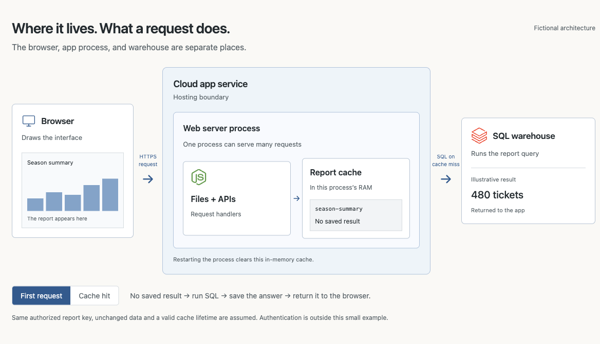
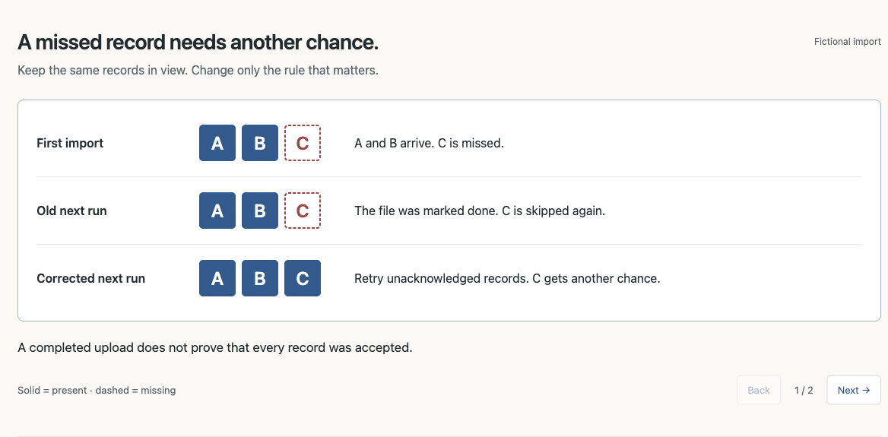
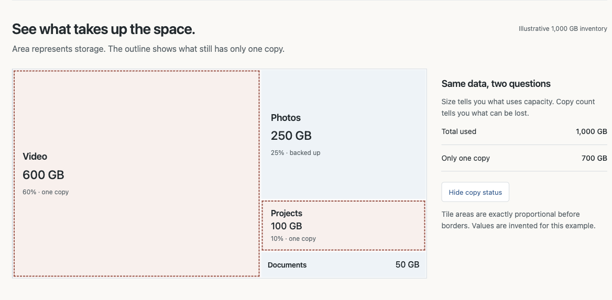
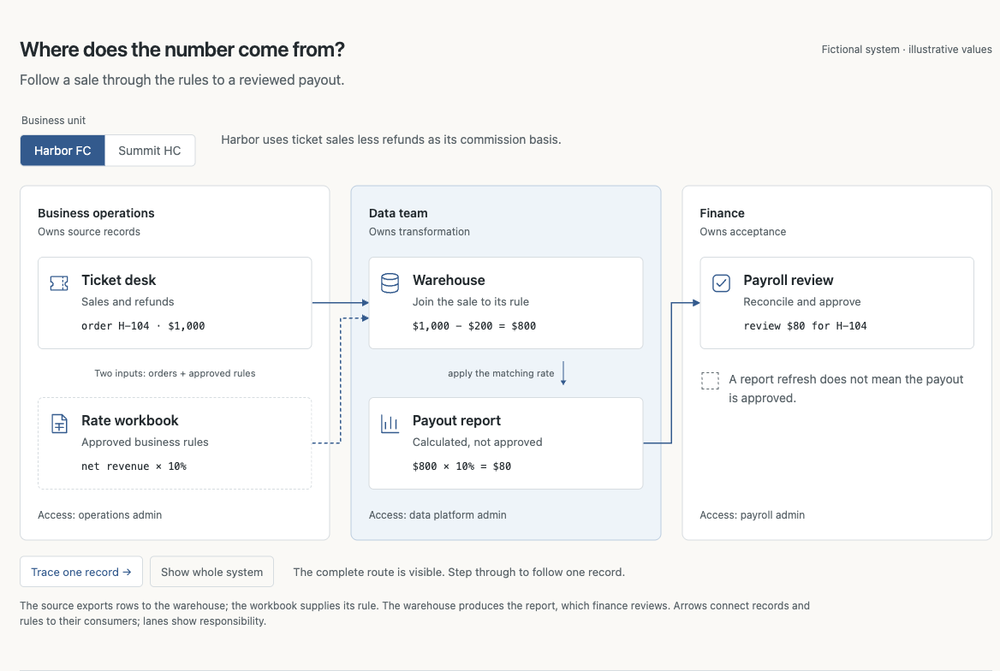
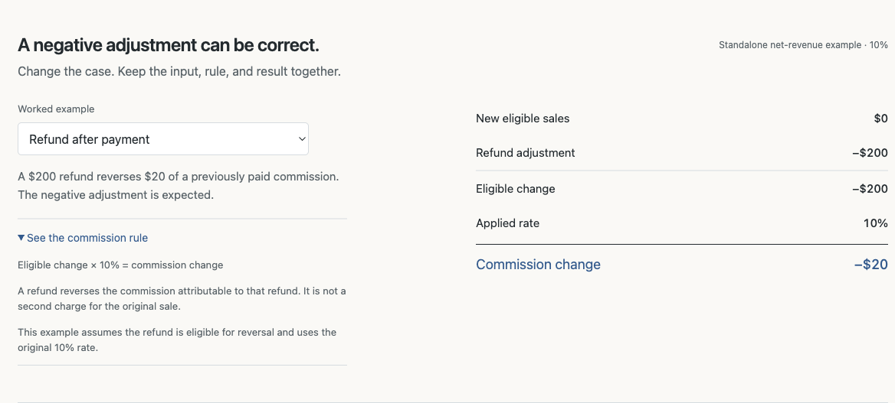

# Sexy Documentation

**Show the source. Follow the rule. Make the result obvious.**

One reusable skill for system diagrams, worked examples, and clear technical documentation. Built around a simple preference: less prose to decode, more mechanism to see.

[**Explore the live examples →**](https://jerryshi042003.github.io/sexy-documentation/) · [Read the skill](SKILL.md) · [Inspiration & credits](references/inspiration.md)

## Five favorite visual patterns

Public adaptations of the visual styles I keep coming back to. The original private diagrams stay private; these demos use fictional systems and values.

### Hosting and cache boundaries

What lives inside the server, what runs elsewhere, and why a second request can skip SQL. Adapted from my favorite hosting explanation and the “Zach idea” visual reference.

[](https://jerryshi042003.github.io/sexy-documentation/examples/favorites.html#hosting)

[Try first request / cache hit →](https://jerryshi042003.github.io/sexy-documentation/examples/favorites.html#hosting)

### Before-and-after slides

The same records stay visible while one rule changes. One situation per slide, with short explanations beside the picture.

[](https://jerryshi042003.github.io/sexy-documentation/examples/favorites.html#slides)

[Step through the two situations →](https://jerryshi042003.github.io/sexy-documentation/examples/favorites.html#slides)

### Storage at a glance

A spatial map makes size and containment obvious. Switch the copy-status overlay without changing the underlying amounts.

[](https://jerryshi042003.github.io/sexy-documentation/examples/favorites.html#storage)

[Explore the storage map →](https://jerryshi042003.github.io/sexy-documentation/examples/favorites.html#storage)

### Trace the whole system

Recognizable sources, one record, ownership boundaries, and business-unit differences. Every box says what it does.

[](https://jerryshi042003.github.io/sexy-documentation/#system)

[Switch the business unit →](https://jerryshi042003.github.io/sexy-documentation/#system)

### Show the calculation—and keep the useful dropdown

A refund can correctly produce a negative commission. The rule, inputs, and result stay together.

[](https://jerryshi042003.github.io/sexy-documentation/#calculation)

[Try the commission cases →](https://jerryshi042003.github.io/sexy-documentation/#calculation)

## One entry point

[**SKILL.md**](SKILL.md) contains the complete workflow: source research, ownership boundaries, business-unit differences, visual choices, worked examples, typography, purposeful interaction, prompt templates, and verification.

Give it to your coding agent with the task and source material:

```text
Read SKILL.md. Explain this system for a new analyst.
Trace one record from its source to the final result.
Show what changes between business units and who owns each handoff.
Keep the useful examples and rule dropdowns. Verify facts before drawing.
```

To install in Codex, clone this repository into an unused skill folder:

```sh
git clone https://github.com/jerryshi042003/sexy-documentation.git \
  ~/.codex/skills/sexy-documentation
```

Then invoke `$sexy-documentation`. For another agent, point it at `SKILL.md`; no particular model, service, or library is required. Existing skills do not need to be replaced.

Also included: [manual versus pipeline release](https://jerryshi042003.github.io/sexy-documentation/#workflow).

Business units, records, rules, and amounts are fictional. Product marks identify real tools; the diagrams do not describe an employer’s architecture or compensation policy.

## What this prefers

- Visible source meaning and responsibility, rather than unexplained product names.
- Consistent type, restrained color, readable labels, and short nearby explanations.
- Examples that resolve the actual confusion, including exceptions and reconciliation.
- Useful dropdowns preserved; redundant wrappers and hidden main explanations removed.
- Controls connected to a real model; motion only when it explains a change.

[The inspiration notes](references/inspiration.md) credit Karpathy, Bret Victor, Simon Willison, Red Blob Games, Mike Bostock, Distill, Jason Zhou, Impeccable, and explanation-skill authors. [The toolkit](references/toolkit.md) explains HTML, CSS, SVG, JavaScript, and GSAP without pretending a library alone makes an explanation good.

## Run and adapt

Open `index.html` directly, or serve the directory:

```sh
python3 -m http.server 8000
```

The gallery has no build step or external runtime dependencies. Content lives in `index.html`, design tokens in `examples/style.css`, and fictional calculations in `examples/model.js`.

Run the calculation checks with Node.js:

```sh
node --test tests/model.test.cjs
```

Use [the evaluation cases](tests/evaluation-cases.md) to assess an agent's decisions. They are a test plan, not a claim of a measured teaching benchmark.

MIT licensed original writing and code. Linked sources keep their own terms.
